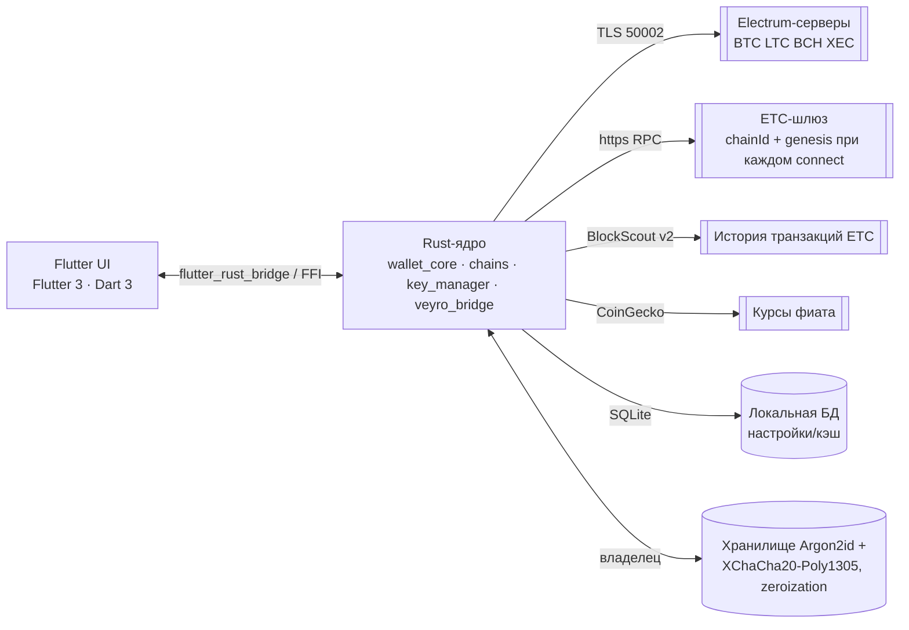

<div align="center">


# VEYRO

**Некастодиальный мультивалютный криптовалютный кошелёк**

*Ваши ключи. Ваше золото. Никаких серверов.*

[](https://github.com/Zylvek/veyro/releases/latest)
[](https://github.com/Zylvek/veyro/releases/latest)
[](https://flutter.dev)
[](https://rust-lang.org)
[](#лицензия)
[](#статус-монет-честно)

**English summary below** · Полные паспорта монет в [`docs/coins/`](docs/coins)

</div>

---

## Что такое VEYRO

Некастодиальный кошелёк, в котором приватные ключи **никогда не покидают
устройство**. Ни серверов разработчика, ни центральной синхронизации,
ни аккаунтов. Каждая монета общается со своей сетью по родному протоколу
(Electrum TLS, публичные RPC, P2P) и включается в продукт только после
**полного живого тест-цикла** — без выдуманных балансов, заглушек
и «скоро заработает».

**Принципы**

- 🔑 **Кастодиальность = 0.** Ключи не встречают FFI-границу и не покидают Rust-ядро.
- 🛡 **TLS-only.** Все соединения к узлам — `ssl://` / `https://`; P2P — проверка magic/genesis.
- 🧾 **Честность интерфейса.** `researched ≠ implemented`; нулей вместо «не синхронизировано» не бывает.
- 🚫 **Только кошелёк.** Никаких обменов, свапов, стейкинга, DeFi, рекламы.

## Скачивание

Готовый установщик — в [Releases](https://github.com/Zylvek/veyro/releases/latest):

| Установщик | SHA-256 |
|---|---|
| `VEYRO-setup-1.0.0.exe` | `D7CE0980E5A1CA2F7596AD47B77BFE8DBE151E1488AAAFD2AEED88D340B84DD0` |

- Установка: иконка на рабочем столе + ярлык в Пуске; по умолчанию per-user
  (права администратора не нужны).
- Данные кошельков живут в `%APPDATA%\veyro` и **переживают** деинсталляцию.
- Артефакт пока не подписан кодовым сертификатом — сверяйте SHA-256;
  SmartScreen может попросить подтверждение при первом запуске.

<details>
<summary><b>Английское резюме</b> (EN summary)</summary>

VEYRO is a self-custodial multi-cryptocurrency wallet — Flutter UI on top of a
Rust core, zero developer servers. Private keys never cross the FFI boundary
(they live and die inside Rust with zeroization). Network access is TLS-only
with genesis/hash fund-safety checks on every connect. Coins are integrated
only after a full live testnet cycle: BTC (testnet4 send), XEC (testnet3 send),
ETC (Mordor send), BCH/LTC (live receive). Recovery is by seed phrase only
(12/24 BIP39); there are no backups, no cloud sync, no accounts. Currently 5 of
26 researched assets are implemented — statuses are honest and never inflated.
</details>

## Статус монет — честно

Статусы никогда не завышаются. Исследования каждой сети — в паспортах
[`docs/coins/`](docs/coins). Матрица обновляется только после полного живого
тест-цикла.

| Монета | Статус | Проверено |
|---|---|---|
| BTC | ✅ Send supported **· реализован** | полный живой цикл на testnet4: faucet → self-transfer → broadcast → mempool → история |
| XEC (eCash) | ✅ Send supported **· реализован** | полный живой цикл testnet3: коннект → скан → история → отправка → подтверждение |
| ETC | ✅ Send supported **· реализован** | полный живой цикл Mordor: подпись EIP-155 → broadcast → receipt (блок 17 414 966), fee-честность |
| BCH | ✅ Receive supported **· реализован** | cashaddr+legacy, Electrum TLS; UAHF-подпись проверена векторами BCHN + живой сетью |
| LTC | ✅ Receive supported **· реализован** | ltc1 bech32, m/84'/2', живая синхронизация |
| RVN, XNA | 🧊 Заморожено честно | P2P-стек готов (kawpow/DGW3/кворум), community-инфраструктура мертва — включится сам при появлении узла вне IBD |
| остальные 21 | 🔬 Research | исследования в паспортах; никакого фасада |

## Архитектура



- **Rust-ядро** (`rust/`): BIP39/32/44/84/61, UTXO-сканирование с gap-лимитом,
  планирование транзакций, **локальная подпись** (BIP143 SegWit, UAHF-forkid для
  BCH-семейства, RLP + EIP-155 с восстановлением подписанта для EVM), идемпотентный
  broadcast (`already known` — честно), история с честным усечением.
- **P2P-клиент** (`rust/crates/chains/p2p/`): handshake 70028, DoH-сид-резолв,
  кворум 2+ с побайтовым кросс-чеком, DGW3 + kawpow (вендоренный C, MIT/Apache).
- **Flutter UI** (`apps/veyro/`): Обзор, центры управления, каталог с живыми
  балансами, история по монетам, RU/EN, бренд-система лого-анимаций.

## Безопасность

- 🔐 Хранилище: пароль → **Argon2id** → **XChaCha20-Poly1305**; zeroization секретов.
- 🧨 Брутфорс-дроссель unlock (250 мс·2ⁿ, cap 4 с).
- 📐 Валидация всех значений на границе Dart→Rust (id, лимиты, арифметика).
- 🌐 Genesis/chainId-чек каждого сервера при каждом подключении (fund-safety).
- 📵 Секреты никогда не в логах, не в отчётах об ошибках, не в UI.
- 🔁 Восстановление exclusively по seed-фразе 12/24 (BIP39). Без бэкапов, без облака.

## Сборка из исходников

Требования: Flutter 3 (Dart 3) + Rust stable + MSVC toolchain.

```powershell
# 1) ядро — тесты
cd rust
cargo fmt --check
cargo clippy --all-targets
cargo test
cargo audit

# 2) Dart-обвязка (после изменения Rust-мостов)
cd ..\apps\veyro
powershell -ExecutionPolicy Bypass -File run_frb_codegen.ps1

# 3) приложение
dart analyze
flutter test
flutter build windows --release
```

> Живые сетевые пробы — гейтнутые тесты, запускаются вручную:
> `cargo test -p chains --test etc_e2e etc_mordor_full_cycle -- --ignored --nocapture`

Установщик одной командой (Inno Setup 7):

```powershell
powershell -ExecutionPolicy Bypass -File installer\build_installer.ps1
```

Паспорт каждой сети: [`docs/coins/<ТИКЕР>.md`](docs/coins) — история,
криптопрофиль, риски, вывод для матрицы.

## Лицензия

Проект — **AGPL-3.0-only** (файл [`LICENSE`](LICENSE), полный текст
GNU Affero General Public License v3 от 19 ноября 2007). Смысл в одном
абзаце: любой, кто модифицирует и распространяет код, а также **запускает
модифицированную версию как сетевой сервис**, обязан опубликовать исходники
своей версии. Проприетарные форки и реребрендинги исключены; изменения
принимаются только обратно под AGPL-3.0-only.

- Исключение — вендоренный KAWPOW-хэш (`rust/crates/kawpow_ffi/ffi`,
  MintPond/Ravencoin): остаётся под `MIT OR Apache-2.0`
  (`LICENSE-MIT` / `LICENSE-APACHE`).
- Название VEYRO, логотип и бренд-ассеты **не являются частью**
  лицензируемого кода: производные сборки обязаны использовать
  собственное имя и знак.
- Лицензии зависимостей сверялись при исследовании каждой сети
  (раздел 7 паспортов): все они совместимы с AGPL — от MIT/Apache
  до BSD/ISC; GPL-компоненты не линкуются в ядро.

## Отказ от гарантий

Программа поставляется «как есть», без каких-либо гарантий полезности
или пригодности (AGPL, §15–17); авторы не несут ответственности за
убытки. Это **не финансовый сервис**, не кастодиальное посредничество
и не инвестиционная рекомендация: ключи и средства — исключительно
под контролем владельца.

---

<div align="center">
<i>Не финансовый сервис. Не кастодиальный агент. Ключи — только у владельца.</i><br/>
<sup>VEYRO · 2026</sup>
</div>
