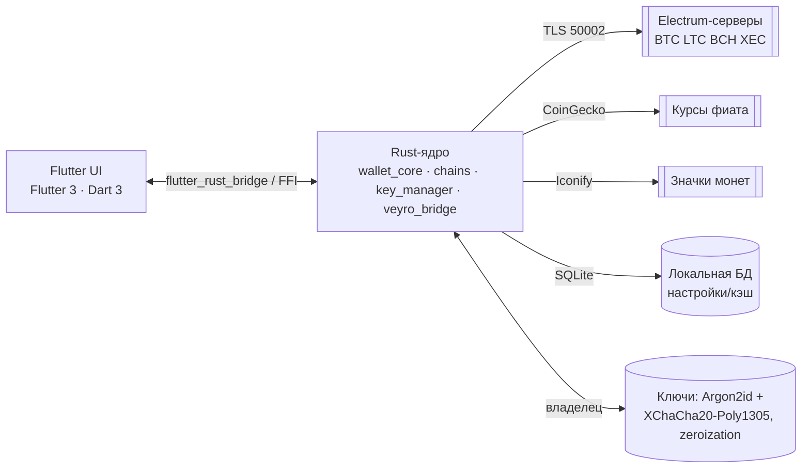

<div align="center">

# VEYRO

**Некастодиальный мультивалютный криптовалютный кошелёк**
Rust-ядро + Flutter, без своего серверного бэкенда.

`Windows · Linux · Android`

</div>

---

## Что это

VEYRO — некастодиальный кошелёк: приватные ключи никогда не покидают устройство
пользователя. Никаких собственных серверов, ни центральных узлов синхронизации,
ни кастодиальных аккаунтов. Каждая монета работает через её родной протокол
(Electrum TLS, P2P, публичные RPC/REST) и включается в продукт **только после
полного живого тест-цикла** — никаких выдуманных балансов и заглушек.

## Монеты — честный статус матрицы

Статус честный и никогда не завышается. Полный реестр — `docs/COIN_COMPATIBILITY.md`,
паспорта монет — `docs/coins/<ТИКЕР>.md`.

| Монета | Статус | Что работает |
|---|---|---|
| BTC | Send supported · **реализован** | полный живой цикл на testnet4: faucet → self-transfer → broadcast → mempool → история → lock |
| BCH | Receive supported · **реализован** | cashaddr+legacy, BIP44 145, Electrum TLS, UAHF-подпись проверена векторами BCHN + живой ECDSA-подписью |
| XEC (eCash) | Send supported · **реализован** | профиль BCH; полный живой цикл на testnet3 (ectest) 16.11.2026: коннект → скан → история → отправка → подтверждение |
| LTC | Receive supported · **реализован** | ltc1 bech32, m/84'/2', живая синхронизация; отправка через общую tx-машину |
| RVN, DGB, XNA… | Research | паспорта готовы, адаптеры в очереди: **P2P-SPV-план** для RVN/XNA (живая P2P-сеть подтверждена пробами), инфраструктурные блокеры зафиксированы честно в паспортах |
| прочие (20) | Research / Blocked | исследования в `docs/coins/`, никаких имитаций балансов |

## Архитектура



- **Rust-ядро** (`rust/`): BIP39/32/44/84, UTXO-сканирование с gap-лимитом,
  планирование транзакций, локальная подпись (BIP143 для SegWit, UAHF-forkid
  для BCH-семейства, legacy ECDSA для RVN-профиля), идемпотентный broadcast,
  честная история с усечением.
- **Flutter UI** (`apps/veyro/`): Обзор, центры управления монетами,
  receive/send/history/details, каталог активов с живыми балансами
  реализованных монет.
- **Сеть**: только серверы, проверенные genesis-битвектором на входе
  (fund-safety), TLS-only политика, фейловер по списку кандидатов,
  дроссель брутфорса, throttle сессий.

## Безопасность

- Хранилище: пароль → **Argon2id** → AES-ключ → **XChaCha20-Poly1305**.
- Секреты живут в Rust-ядре, zeroize при освобождении; в Dart не попадают.
- Валидация ввода на границе ядра (утверждённые форматы адресов, u64 сатоши без float).
- Политика TLS-only для сетевого транспорта; genesis-чек каждого сервера.
- Политика секретов: никогда не в логах, не в отчётах об ошибках, не в UI.

Полный аудит-лист: `docs/security/`.

## Сборка

Требования: Flutter 3 (Dart 3) + Rust stable + MSVC/CLang, диск `D`.

```powershell
# ядро (тесты)
cd rust
cargo fmt --check; cargo clippy --all-targets; cargo test

# Dart-обвязка (после изменения Rust-мостов)
cd ../apps/veyro
powershell -ExecutionPolicy Bypass -File run_frb_codegen.ps1

# приложение
dart analyze
flutter test
flutter build windows --release
```

Живые сетевые пробы монет — гейтнутые тесты (запуск вручную):
`cargo test -p chains --test xec_e2e -- --ignored --nocapture`.

## Структура репозитория

```
veyro/
├── apps/veyro/       Flutter-приложение (UI, l10n RU/EN, тесты)
├── rust/crates/
│   ├── chains/       Адаптеры монет (btc, litecoin, cash+BCH/XEC, raven…)
│   ├── veyro_bridge/ Мост FFI (api/*.rs, сессии, codegen → Dart)
│   ├── wallet_core/  Хранилище кошельков (шифрованиеArgon2id/…)
│   ├── key_manager/  BIP39/BIP32 derivation
│   └── …
├── docs/
│   ├── coins/        Паспорта монет (26 шт, честные исследования)
│   ├── security/     Аудит безопасности
│   ├── MASTER_PROMPT.md   Стратегия/решения владельца (versioned)
│   └── COIN_COMPATIBILITY.md  Матрица честных статусов
└── scripts/          env.ps1 (диск D-конвенция)
```

## Лицензия

Код — **MIT OR Apache-2.0** (двухслойная, файлы `LICENSE-MIT`, `LICENSE-APACHE`).
Зависимости отобраны под совместимость лицензий (аудит `cargo audit` — без
уязвимостей).

---

<div align="center">
<i>Не финансовый сервис. Не кастодиальный агент. Ключи только у владельца.</i>
</div>
